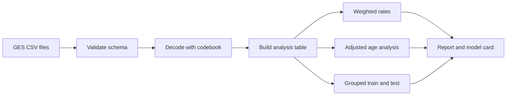
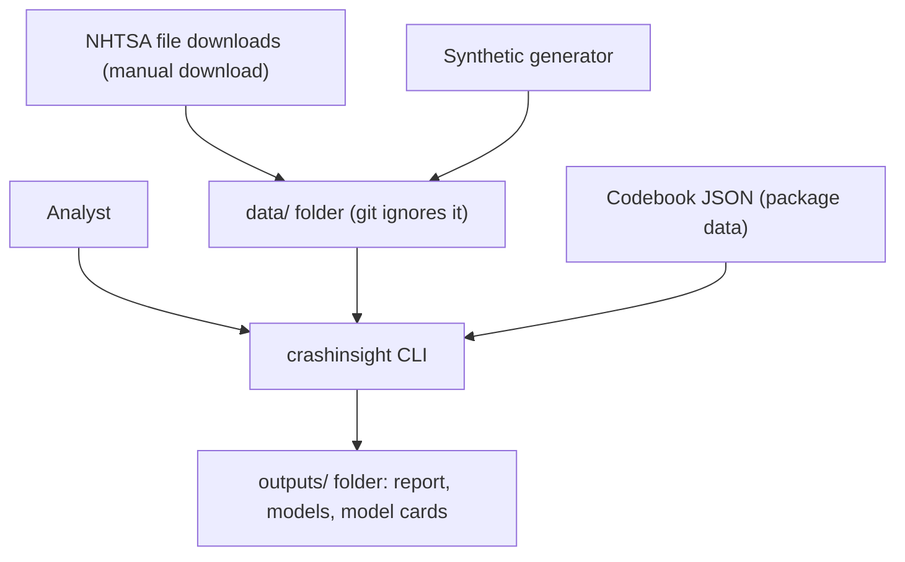
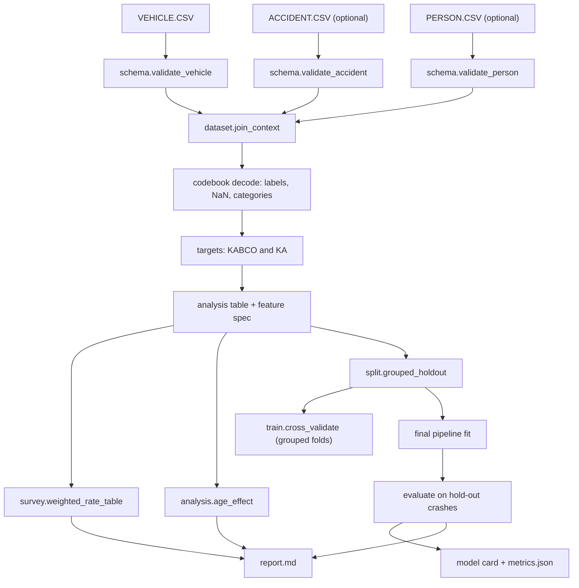

<div align="center">

# crashinsight — Survey-Aware Injury Severity Analysis on NHTSA GES Crash Data

**crashinsight is a crash-severity study kit for analysts who use the NHTSA General Estimates System (GES). It takes the raw GES files through these steps to weighted estimates, an adjusted age analysis and evaluated models:**

`validate` → `decode` → `build` → `weight` → `train` → `evaluate` → `report`.


**[Summary](#1-summary)** ·
**[Workflow](#4-the-end-to-end-workflow)** ·
**[Run it](#13-how-to-run-crashinsight)** ·
**[Configuration](#134-environment-variables)** ·
**[Known problems](#16-known-problems)** ·
**[Glossary](#18-glossary)**

</div>

> [!NOTE]
> This README uses ASD-STE100 Simplified Technical English. The writing rules and the project
> vocabulary are in [`docs/ste-style-guide.md`](docs/ste-style-guide.md). Each term in the
> [Glossary](#18-glossary) has only one meaning.

---

> [!WARNING]
> Do not use crashinsight for decisions about a person, an insurance claim or a medical triage.
> The models show association, not cause. A human analyst must review each result before publication.

crashinsight studies which vehicle and crash factors relate to injury severity in police-reported US crashes.
It decodes GES codes with a codebook file, not with labels in the code.
Sentinel codes never become numbers, and no outlier filter removes the serious and fatal injuries.
National rates use the GES weight, strata and PSUs.
Each model is a scikit-learn pipeline with a crash-grouped split, a majority baseline and metrics for a rare class.

This README is the **one location that explains all of crashinsight**. It gives these topics:

- the general design
- each component and its procedure, step by step
- the decision rules
- the data map
- the runbook
- the validation results and the known problems

| If you are… | Read |
|---|---|
| A manager or reviewer | [1](#1-summary), [3](#3-design-rules), [4](#4-the-end-to-end-workflow), [15](#15-validation-results), [17](#17-key-points) |
| A developer who joins the project | All sections, in sequence. Keep [13](#13-how-to-run-crashinsight) and [16](#16-known-problems) open while you work |
| An analyst who runs crashinsight | [13](#13-how-to-run-crashinsight), then the section for the component that you use |

---

## Table of contents

1. 🧭 [Summary](#1-summary)
2. 🏗️ [How crashinsight is built](#2-how-crashinsight-is-built)
   - 2.1 [Components](#21-components)
   - 2.2 [System context](#22-system-context)
   - 2.3 [Repository layout](#23-repository-layout)
3. 🛡️ [Design rules](#3-design-rules)
4. 🔄 [The end-to-end workflow](#4-the-end-to-end-workflow)
   - 4.1 [Full flow](#41-full-flow)
   - 4.2 [The life cycle of one vehicle row](#42-the-life-cycle-of-one-vehicle-row)
5. 🔵 [The codebook and the decoder](#5-the-codebook-and-the-decoder)
6. 🟢 [The analysis table](#6-the-analysis-table)
7. 🟣 [Survey-weighted rates](#7-survey-weighted-rates)
8. 📐 [The vehicle-age analysis](#8-the-vehicle-age-analysis)
9. 🤖 [Splits and model pipelines](#9-splits-and-model-pipelines)
10. 📏 [Evaluation and explanations](#10-evaluation-and-explanations)
11. ⚖️ [The decision rules](#11-the-decision-rules)
12. 🗂️ [Data and file map](#12-data-and-file-map)
13. ▶️ [How to run crashinsight](#13-how-to-run-crashinsight)
    - 13.1 [Prerequisites](#131-prerequisites) · 13.2 [Installation](#132-installation) · 13.3 [Run crashinsight](#133-run-crashinsight) · 13.4 [Environment variables](#134-environment-variables)
14. 🧩 [How to extend crashinsight](#14-how-to-extend-crashinsight)
15. ✅ [Validation results](#15-validation-results)
16. ⚠️ [Known problems](#16-known-problems)
17. 📌 [Key points](#17-key-points)
18. 📖 [Glossary](#18-glossary)
19. 📄 [License](#19-license)

---

## 1. Summary

**The problem.** GES is a stratified, clustered sample of police-reported crashes, and its files contain integer codes. These questions are difficult:

- Which label belongs to each code, and which codes mean unknown or not applicable?
- How do you keep the rare serious and fatal injuries in the data?
- How do you make a national rate from a weighted sample, with a correct standard error?
- Does vehicle age relate to serious injury after control for other crash factors?
- How do you measure a model on a rare class without a leak between vehicles of one crash?

crashinsight gives each of these questions its own component. Each component has a validated input and a tested output.

| Item | Value |
|---|---|
| Input | GES `VEHICLE.CSV` (required), `ACCIDENT.CSV` and `PERSON.CSV` (optional) |
| Output | Validation report, weighted KA rates, adjusted odds ratio, saved models with model cards, Markdown report |
| Components | **13** modules: config, codebook, schema, dataset, survey, analysis, split, models, evaluate, train, explain, report, synthetic, plus the CLI |
| Targets | `ka` (serious or fatal vs. not) and `kabco` (O, C, B, A, K) |
| Models | `majority` baseline, `logreg`, `forest`, `boosting`, `ordinal` |
| Offline mode | The synthetic generator writes GES-like files. All commands and all tests run with no download and no network |
| Safety | No outlier filter. No sentinel code as a number. No crash on both sides of a split |
| Tests | **53** unit tests (`pytest`), 1 more skips without the optional `shap` package |



---

## 2. How crashinsight is built

### 2.1 Components

| Component | Module | Purpose |
|---|---|---|
| Settings | `src/crashinsight/config.py` | Environment variables: data folder, output folder, seed, crash year, number of folds |
| Codebook | `src/crashinsight/codebook.py`, `src/crashinsight/data/codebook_ges2015.json` | Labels, sentinel codes, valid ranges, decode rules |
| Schema | `src/crashinsight/schema.py` | Load the CSV files. Check the columns, the integer codes, the weights and the keys |
| Analysis table | `src/crashinsight/dataset.py` | Join ACCIDENT and PERSON, decode features, make the KABCO and KA targets |
| Survey estimates | `src/crashinsight/survey.py` | Weighted rates with Taylor linearization standard errors |
| Age analysis | `src/crashinsight/analysis.py` | Weighted logistic regression with controls and a PSU bootstrap |
| Splits | `src/crashinsight/split.py` | Crash-grouped, stratified folds and hold-out test |
| Model pipelines | `src/crashinsight/models.py` | Preprocessor and estimators, including the ordinal model |
| Metrics | `src/crashinsight/evaluate.py` | Macro-F1, recall for each class, KA PR-AUC, Brier score, calibration, bootstrap CIs |
| Training | `src/crashinsight/train.py` | Cross-validation, hold-out test, save, load, model card |
| Explanations | `src/crashinsight/explain.py` | Permutation importance. SHAP as an optional extra |
| Report | `src/crashinsight/report.py` | Markdown report with all tables |
| Synthetic data | `src/crashinsight/synthetic.py` | GES-like VEHICLE, ACCIDENT and PERSON files with a known signal |
| CLI | `src/crashinsight/cli.py` | `synth`, `validate`, `describe`, `age-effect`, `train`, `evaluate`, `report`, `demo` |

### 2.2 System context



crashinsight has no network client. The analyst downloads the NHTSA files by hand (see [`data/README.md`](data/README.md)).

### 2.3 Repository layout

```
crashinsight/
├── .github/workflows/ci.yml        # CI: install .[dev], run pytest
├── data/README.md                  # source, licence, expected files, download steps
├── docs/ste-style-guide.md         # writing rules and project vocabulary
├── src/crashinsight/
│   ├── data/codebook_ges2015.json  # codebook: labels and sentinel codes
│   ├── config.py                   # settings from environment variables
│   ├── codebook.py                 # decode rules
│   ├── schema.py                   # file loading and schema checks
│   ├── dataset.py                  # analysis table, targets, feature spec
│   ├── survey.py                   # weighted rates and linearized variance
│   ├── analysis.py                 # adjusted vehicle-age analysis
│   ├── split.py                    # crash-grouped splits
│   ├── models.py                   # pipelines and the ordinal model
│   ├── evaluate.py                 # metrics for a rare class
│   ├── train.py                    # CV, hold-out test, model card
│   ├── explain.py                  # permutation importance, optional SHAP
│   ├── report.py                   # Markdown report
│   ├── synthetic.py                # synthetic GES-like files
│   └── cli.py                      # command-line interface
├── tests/                          # 54 tests (1 needs the optional shap package)
├── .env.example                    # variable names only
└── pyproject.toml                  # package, extras, console script
```

---

## 3. Design rules

### 3.1 Labels come from a codebook file

The code contains no label dictionaries. `codebook_ges2015.json` gives the label of each code, the sentinel codes and the valid range of each numeric variable. The file names its source, the NHTSA manual DOT HS 812 320. `crashinsight validate` lists each code in the data that has no label.

### 3.2 A sentinel code is never a number

`Variable.decode` in `codebook.py` changes unknown, not reported and not applicable codes to NaN for numeric and binary variables. For nominal variables, they become the categories `Unknown` and `Not applicable`. For example, `TRAV_SP` = 998 and `MOD_YEAR` = 9999 become NaN.

### 3.3 No outlier filter

crashinsight never applies an IQR filter or a similar filter to codes. All K and A rows stay in the data. Only rows with an unknown or a not applicable severity leave the table, and `build_dataset` counts them.

### 3.4 Nominal codes are categories

`models.py` one-hot encodes each nominal feature. A nominal feature is never scaled and never used as a number. Rare categories (fewer than 10 training rows) go into one "infrequent" column.

### 3.5 The preprocessor is fit on training rows only

The imputers, the scaler and the encoder are steps of one scikit-learn `Pipeline`. Cross-validation fits a new pipeline in each fold. Thus no statistic from a test row enters the training.

### 3.6 All vehicles of one crash stay together

`split.py` uses `StratifiedGroupKFold` with `CASENUM` as the group. `assert_disjoint_groups` stops the run if one crash is on both sides of a split.

### 3.7 National rates use the survey design

`survey.py` uses `WEIGHT` for each rate. The standard error uses the variance strata (`PSUSTRAT`) and the PSUs. The tables also show the unweighted rate, so the reader can see the effect of the weight.

### 3.8 No outcome column is a feature

`LEAKAGE_COLUMNS` in `dataset.py` lists the columns that describe the outcome or the events after the crash: `MAX_VSEV`, `MXVSEV_IM`, `NUM_INJV`, `NUMINJ_IM`, `DEFORMED`, `TOWED` and `FIRE_EXP`. A test checks that no feature comes from them.

---

## 4. The end-to-end workflow

### 4.1 Full flow



### 4.2 The life cycle of one vehicle row

1. `load_tables` reads the row from `VEHICLE.CSV` with Latin-1 encoding.
2. `validate_vehicle` checks the columns, the integer codes, the weight and the key.
3. `join_context` adds the light and weather of the crash and the age and sex of the driver.
4. The codebook decodes each source column into a feature.
5. `kabco_from_max_vsev` gives the KABCO letter. If the severity is unknown, the row leaves the table.
6. The row goes into one weighted rate for each grouping variable.
7. The split puts the row, with all other vehicles of its crash, in training or in the hold-out test.
8. The pipeline imputes, encodes and scales the row, then the estimator gives the class probabilities.
9. The metrics compare the KA probability of the row with its true KA value.

---

## 5. The codebook and the decoder

**Purpose.** Change each GES code into a label, a number or a missing value, with rules from one file.

| Input | Output |
|---|---|
| Raw integer codes of one variable | Labels (nominal), 0/1/NaN (binary) or numbers/NaN (numeric) |

**Procedure**

1. `load_codebook` reads `codebook_ges2015.json` from the package, or a file that you give.
2. `_parse` checks each entry: the kind, the codes or the ranges, the valid range and the positive codes.
3. `Variable.decode` applies the rule of the kind (see the table below).
4. `Codebook.undecoded_codes` lists the codes in a table that have no label and are not sentinels.
5. `Codebook.sentinel_share` gives the share of sentinel codes in each variable.

| Kind | Valid code | Sentinel code | Code with no label |
|---|---|---|---|
| `nominal` | Label from `codes` or `ranges` | `Unknown` or `Not applicable` | NaN, and `validate` reports it |
| `ordinal` | Label from `codes` | `Unknown` or `Not applicable` | NaN, and `validate` reports it |
| `binary` | 1 for a `positive` code, else 0 | NaN | NaN |
| `numeric` | The number, or the `topcode` value | NaN | NaN when outside `valid` |

**Codebook coverage.** The bundled file has 23 variables: 19 from VEHICLE, 2 from ACCIDENT and 2 from PERSON.
`BODY_TYP` uses the group ranges of the manual (for example 1–13 passenger car, 80–89 motorcycle), not a label for each code.

**Rules**

- A numeric variable must have a valid range. A binary variable must have positive codes.
- `MAKE` and `MODEL` are not in the codebook. crashinsight does not use them as features.

---

## 6. The analysis table

**Purpose.** Make one row for each vehicle with a known severity, with decoded features, targets and design columns.

| Input | Output |
|---|---|
| Validated VEHICLE, optional ACCIDENT and PERSON tables | `BuildResult`: table, `FeatureSpec`, counts of removed rows |

**Procedure**

1. Join ACCIDENT on `CASENUM` (many vehicles to one crash).
2. Join the driver row of PERSON (`PER_TYP` = 1) on `CASENUM` and `VEH_NO`.
3. Decode the numeric features: `travel_speed`, `speed_limit`, `occupants`, `driver_age`.
4. Calculate `vehicle_age` = crash year − model year, with a minimum of 0. The crash year comes from `CRASHINSIGHT_CRASH_YEAR` (default 2015).
5. Decode the binary features: `hit_run`, `rollover`, `alcohol`, `speeding`.
6. Decode the nominal features: `region`, `body_group`, `collision_manner`, `surface`, `trafficway`, `alignment`, `grade`, `weight_class`, `light`, `weather`, `driver_sex`, `time_of_day`.
7. Map `MAX_VSEV` to KABCO and to KA. Remove the rows with an unknown or a not applicable severity.

| Feature | Source | Kind |
|---|---|---|
| `travel_speed` | `TRAV_SP` | numeric (mph) |
| `speed_limit` | `VSPD_LIM` | numeric (mph) |
| `occupants` | `NUMOCCS` | numeric |
| `driver_age` | PERSON `AGE` | numeric (years) |
| `vehicle_age` | `MOD_YEAR` and the crash year | numeric (years) |
| `hit_run`, `rollover`, `alcohol`, `speeding` | `HIT_RUN`, `ROLLOVER`, `VEH_ALCH`, `SPEEDREL` | binary |
| `region`, `body_group`, `collision_manner`, `surface` | `REGION`, `BODY_TYP`, `MAN_COLL`, `VSURCOND` | nominal |
| `trafficway`, `alignment`, `grade`, `weight_class` | `VTRAFWAY`, `VALIGN`, `VPROFILE`, `GVWR` | nominal |
| `light`, `weather`, `driver_sex` | ACCIDENT `LGT_COND`, `WEATHER`, PERSON `SEX` | nominal |
| `time_of_day` | `HOUR`, in 5 bands | nominal |

**Rules**

- If a source column is not in the files, its feature is not in the feature spec.
- The crash year is the year of the data, not the year of the analysis.

---

## 7. Survey-weighted rates

**Purpose.** Give a national estimate of the KA rate for each level of a grouping variable, with a standard error.

| Input | Output |
|---|---|
| Analysis table, grouping column | Table: `n`, `weighted_n`, `rate`, `se`, `ci_low`, `ci_high`, `unweighted_rate`, `small_cell` |

**Procedure**

1. For each level of the grouping column, mark the rows of the domain.
2. Calculate the rate as sum(weight × KA) / sum(weight) in the domain.
3. Make the linearized values z = weight × (KA − rate) / sum(weight) in the domain, and z = 0 outside it.
4. Add z in each PSU. In each stratum, calculate n/(n − 1) × the sum of squared deviations of the PSU totals.
5. The standard error is the square root of the sum over the strata. The 95% CI is rate ± 1.96 × SE.

**Rules**

- Rows outside the domain stay in the design with z = 0. Thus a PSU with no domain rows still counts.
- A stratum with one PSU adds no variance.
- `small_cell` is `True` when the domain has fewer than 30 rows.

---

## 8. The vehicle-age analysis

**Purpose.** Answer one question with controls: do newer vehicles (10 model years or less at the crash) have different odds of KA than older vehicles?

| Input | Output |
|---|---|
| Analysis table | `AgeEffect`: weighted KA rate of each group with SE, adjusted odds ratio, bootstrap CI |

**Hypotheses.** H0: the adjusted odds ratio (newer vs. older) is 1. H1: the odds ratio is not 1 (two-sided).

**Procedure**

1. Remove the rows with an unknown model year. Set `newer` = 1 if `vehicle_age` ≤ 10.
2. Calculate the weighted KA rate of each group as a domain rate (see [7](#7-survey-weighted-rates)).
3. Fit a weighted logistic regression of KA on `newer` and the controls.
4. Draw the PSUs of each stratum with replacement, fit the model again, and keep the `newer` coefficient.
5. The 95% CI is the 2.5 and 97.5 percentiles of the exponent of the coefficients.

| Control | Kind |
|---|---|
| `body_group`, `collision_manner`, `region`, `time_of_day`, `light` | nominal, one-hot with the first level dropped |
| `speed_limit` | numeric, median imputation with a missing indicator |
| `rollover`, `alcohol`, `speeding` | binary, 0 for missing with a missing indicator |

**Rules**

- The default number of bootstrap draws is 50 (`--bootstrap`). A draw with only one KA class is skipped.
- If a control is not in the table, the model uses the other controls.

---

## 9. Splits and model pipelines

**Purpose.** Train models that a reader can compare and reproduce, with no leak between training and test rows.

| Input | Output |
|---|---|
| Analysis table, target, model name, seed | Fitted pipeline, CV result, hold-out metrics, baseline metrics |

**Procedure**

1. `grouped_holdout` keeps one fold of a 5-fold `StratifiedGroupKFold` as the hold-out test (about 20% of the crashes).
2. `cross_validate` runs `CRASHINSIGHT_N_SPLITS` grouped folds on the training crashes and makes out-of-fold probabilities.
3. `train` fits the final pipeline on all training crashes and evaluates it on the hold-out crashes.
4. `train` also fits the `majority` baseline on the same rows and evaluates it on the same test.
5. `save` writes `model.joblib`, `metrics.json` and `model_card.md`.

| Model | Estimator | Class balance |
|---|---|---|
| `majority` | `DummyClassifier(most_frequent)` | none (the baseline) |
| `logreg` | `LogisticRegression` | `class_weight="balanced"` |
| `forest` | `RandomForestClassifier`, 200 trees, minimum leaf 5 | `balanced_subsample` |
| `boosting` | `HistGradientBoostingClassifier`, 150 iterations, learning rate 0.05, 15 leaves | `class_weight="balanced"` |
| `ordinal` | `OrdinalClassifier` (Frank and Hall): one logistic model for each threshold P(y > k) | `balanced` in each threshold model |

| Preprocessor branch | Steps |
|---|---|
| numeric | median imputer with a missing indicator, standard scaler |
| binary | constant 0 imputer with a missing indicator |
| nominal | constant `Missing` imputer, one-hot encoder (`min_frequency=10`, unknown categories go to "infrequent") |

**Rules**

- The `ordinal` model needs the `kabco` target. The other models accept `ka` and `kabco`.
- The seed comes from `CRASHINSIGHT_SEED`. The same seed gives the same metrics.
- `boosting` uses a fixed number of iterations, because early stopping makes a random row split that ignores crashes.

---

## 10. Evaluation and explanations

**Purpose.** Measure each model on the rare KA class and show which features carry the signal.

| Input | Output |
|---|---|
| True labels, class probabilities, class labels, crash IDs | Metrics dictionary, bootstrap CIs, permutation importance table |

**Procedure**

1. `ka_score` adds the probability columns of the K and A labels. It finds the columns by label, not by position.
2. `classification_metrics` calculates the metrics in the table below.
3. `grouped_bootstrap_ci` draws whole crashes with replacement and gives a percentile CI for macro-F1 and KA PR-AUC.
4. `permutation_table` shuffles one raw feature at a time on the test rows and measures the drop in KA PR-AUC.
5. With the `explain` extra, `shap_values` gives SHAP values for the model step.

| Metric | Meaning |
|---|---|
| `accuracy` | Share of correct classes. It is high for the baseline, so do not use it alone |
| `balanced_accuracy` | Mean recall over the classes |
| `macro_f1` | Mean F1 over the classes |
| `recall_by_class` | Recall of each class |
| `ka_pr_auc` | Average precision of the KA score. The baseline value is the KA prevalence |
| `ka_roc_auc` | ROC AUC of the KA score |
| `ka_brier` | Brier score of the KA score |
| `ka_ece` | Expected calibration error of the KA score, 10 bins |
| `macro_roc_auc_ovr` | One-vs-rest ROC AUC (multi-class target, all classes present) |

---

## 11. The decision rules

**Target rules**

| `MAX_VSEV` | Label | KABCO | KA | In the table? |
|---|---|---|---|---|
| 0 | No apparent injury | O | 0 | Yes |
| 1 | Possible injury | C | 0 | Yes |
| 2 | Suspected minor injury | B | 0 | Yes |
| 3 | Suspected serious injury | A | 1 | Yes |
| 4 | Fatal injury | K | 1 | Yes |
| 5, 9 | Severity unknown, unknown | — | — | No (counted as unknown) |
| 6, 8 | Died before the crash, no occupants | — | — | No (counted as not applicable) |

**Sentinel rules (numeric variables)**

| Variable | Valid range | Sentinel codes | Special |
|---|---|---|---|
| `TRAV_SP` | 0–151 mph | 998, 999 | 997 (more than 151) becomes 152 |
| `VSPD_LIM` | 5–95 mph | 0 (no limit or non-trafficway), 98, 99 | — |
| `MOD_YEAR` | 1900–2016 | 9998, 9999 | — |
| `NUMOCCS` | 0–96 | 97, 98, 99 | — |
| `HOUR` | 0–23 | 99 | — |
| `AGE` | 0–120 | 998, 999 | — |

**Fixed values**

| Value | Where | Number |
|---|---|---|
| Newer vehicle | `analysis.NEWER_MAX_AGE` | `vehicle_age` ≤ 10 |
| Small cell | `weighted_rate_table(min_n=...)` | fewer than 30 rows |
| Rare category | `OneHotEncoder(min_frequency=...)` | fewer than 10 training rows |
| Hold-out size | `grouped_holdout(test_fraction=...)` | 0.2 (allowed 0.05–0.5) |
| Folds | `CRASHINSIGHT_N_SPLITS` | 5 (minimum 2) |
| Calibration bins | `calibration_table(bins=...)` | 10 |

---

## 12. Data and file map

| Path | Committed? | Contents |
|---|---|---|
| `src/crashinsight/data/codebook_ges2015.json` | Yes | Codebook: labels, sentinel codes, ranges |
| `data/README.md` | Yes | Source, licence, expected files and columns, download steps |
| `data/<year>/VEHICLE.CSV`, `ACCIDENT.CSV`, `PERSON.CSV` | No (git ignores `/data/*`) | NHTSA files that you download |
| `data/synthetic/*.CSV` | No | Files from `crashinsight synth` |
| `outputs/<model>_<target>/model.joblib` | No | Pipeline, feature spec, target, codebook version |
| `outputs/<model>_<target>/metrics.json` | No | CV, hold-out and baseline metrics with CIs |
| `outputs/<model>_<target>/model_card.md` | No | Intended use, metrics, limits |
| `outputs/report.md` | No | Full Markdown report |
| `.env` | No | Local settings |

---

## 13. How to run crashinsight

### 13.1 Prerequisites

| Need | For |
|---|---|
| Python 3.11+ | All components |
| GES 2015 CSV files | Real results (see [`data/README.md`](data/README.md)). The demo and the tests do not need them |
| `shap` (extra `explain`) | SHAP values only |

### 13.2 Installation

```bash
git clone https://github.com/KrishnaAnnavaram/crashinsight.git
cd crashinsight
python -m venv .venv
. .venv/bin/activate            # Windows: .venv\Scripts\activate
pip install -e ".[dev]"         # add ,explain for SHAP
```

### 13.3 Run crashinsight

Offline demo (synthetic data, no download, about one minute):

```bash
crashinsight demo
```

Step by step on synthetic files:

```bash
crashinsight synth --out data/synthetic --crashes 3000 --seed 0
crashinsight validate --data data/synthetic
crashinsight describe --data data/synthetic
crashinsight age-effect --data data/synthetic --bootstrap 50
crashinsight train --data data/synthetic --target ka --model boosting
crashinsight train --data data/synthetic --target kabco --model ordinal
crashinsight report --data data/synthetic --out outputs/report.md
```

On the real GES 2015 files:

```bash
crashinsight validate --data data/ges2015
crashinsight report --data data/ges2015 --bootstrap 200
crashinsight train --data data/ges2015 --target ka --model boosting --out outputs/boosting_ka
crashinsight evaluate --data data/other_year --model outputs/boosting_ka/model.joblib
```

| Command | What it does | Exit code |
|---|---|---|
| `synth` | Writes synthetic `VEHICLE.CSV`, `ACCIDENT.CSV`, `PERSON.CSV` | 0 |
| `validate` | Checks the schema, lists codes with no label and the sentinel shares | 0 OK, 2 codes with no label, 1 error |
| `describe` | Prints the weighted KA rates for each grouping variable | 0 |
| `age-effect` | Prints the group rates and the adjusted odds ratio with its CI | 0 |
| `train` | Grouped CV, hold-out test, baseline, saves model, metrics and model card | 0 |
| `evaluate` | Evaluates a saved model on another folder, for example another year | 0 |
| `report` | Writes the Markdown report (data quality, rates, age analysis, models, importance) | 0 |
| `demo` | Runs all steps on synthetic data in a temporary folder | 0 |

### 13.4 Environment variables

| Variable | Used by | Meaning |
|---|---|---|
| `CRASHINSIGHT_DATA_DIR` | `config.Settings` | Default data folder (default `data`) |
| `CRASHINSIGHT_OUTPUT_DIR` | `train`, `report`, `demo` | Output folder (default `outputs`) |
| `CRASHINSIGHT_SEED` | All random steps | Seed for splits, models and bootstraps (default 42) |
| `CRASHINSIGHT_CRASH_YEAR` | `dataset.build_dataset` | Year of the data, for `vehicle_age` (default 2015) |
| `CRASHINSIGHT_N_SPLITS` | `train.cross_validate` | Number of grouped CV folds (default 5, minimum 2) |

crashinsight needs no credentials. `.env.example` gives the variable names. Git ignores `.env`.

---

## 14. How to extend crashinsight

| You want to… | Do this | Code change? |
|---|---|---|
| Add a variable from the manual | Add an entry to the codebook JSON, then add the feature to a `*_SOURCES` map in `dataset.py` | Small |
| Use a CRSS year (2016+) | Make a codebook JSON for that year and load it with `load_codebook(path)` | Small |
| Add a model | Add a branch to `build_estimator` in `models.py` and its name to `MODEL_NAMES` | Small |
| Change the newer-vehicle limit | Change `NEWER_MAX_AGE` in `analysis.py` | Small |
| Add a control to the age analysis | Add the feature name to a `CONTROL_*` list in `analysis.py` | Small |
| Use calibrated probabilities | Wrap the estimator in `CalibratedClassifierCV` with a grouped CV | Yes |
| Get plots | Install the `plots` extra and plot the report tables | Yes |

---

## 15. Validation results

All numbers below come from this repository. The model and age numbers use **synthetic data** (`crashinsight demo`, 3,000 crashes, seed 0). They do not describe real crashes.

| Validation | Result | Command |
|---|---|---|
| Unit tests (local, Python 3.13) | **53 passed, 1 skipped** (SHAP) | `pytest -q` |
| Unit tests (clean venv with `.[dev]` only, as in CI) | **53 passed, 1 skipped** | `pip install -e ".[dev]" && pytest -q` |
| Codebook coverage on synthetic files | 0 codes with no label | `crashinsight validate` |
| Rows kept (synthetic) | 5,105 of 5,422 vehicle rows. 213 unknown and 104 not applicable severity removed | `crashinsight demo` |
| Weighted KA rate, newer vs. older (synthetic) | 0.0707 (SE 0.0051) vs. 0.1220 (SE 0.0071) | `crashinsight age-effect` |
| Adjusted odds ratio, newer vs. older (synthetic) | 0.546, 95% PSU bootstrap CI 0.485–0.641 (30 draws) | `crashinsight age-effect` |

Hold-out test on synthetic data, target `ka` (KA prevalence 0.099):

| Model | Macro-F1 | KA PR-AUC (95% crash bootstrap CI) | KA recall | KA ROC AUC | KA ECE |
|---|---|---|---|---|---|
| `majority` (baseline) | 0.474 | 0.099 (0.084–0.119) | 0.000 | 0.500 | 0.099 |
| `logreg` | 0.516 | 0.210 (0.148–0.301) | 0.490 | 0.631 | 0.327 |
| `boosting` | 0.551 | 0.205 (0.135–0.282) | 0.400 | 0.618 | 0.253 |

The synthetic generator plants a log-odds of 0.35 for older vehicles inside each crash. This gives an odds ratio of about 0.70 for newer vs. older.
The estimate of one seed is 0.546, and its interval does not contain 0.70. A 30-draw bootstrap with 32 PSUs gives a coarse interval.
The baseline has a high accuracy (0.901) but a KA recall of 0. This result shows why crashinsight reports macro-F1 and KA PR-AUC.
The high ECE of the balanced models shows that `class_weight="balanced"` moves the probabilities up. Do not read them as risks.

The prototype reported decision-tree, forest, logistic and MLP accuracies on GES 2015. Those numbers are prototype results, not reproduced here. They came from a table without the K and A classes, so crashinsight does not compare with them.

---

## 16. Known problems

Read these problems before you use crashinsight for a publication.

| # | Area | Problem | Impact and action |
|---|---|---|---|
| 1 | Real data | CI runs on synthetic data only. Results on the real GES 2015 files are not reproduced in CI | Run `crashinsight report --data data/ges2015` and review each table |
| 2 | Codebook | The codebook is transcribed by hand for 23 variables. `BODY_TYP` uses group ranges only | Check each entry against DOT HS 812 320 before publication |
| 3 | Imputed columns | GES gives imputed columns (`*_IM`). crashinsight uses the reported columns with sentinels as missing | Compare with the imputed columns as a sensitivity check |
| 4 | Model metrics | The metrics are unweighted. They describe the sample, not the nation | Use `survey.py` for national statements |
| 5 | Calibration | Balanced class weights make the KA probabilities too high (ECE 0.25–0.33 on synthetic data) | Do not read the probabilities as risks. Add a grouped calibration step |
| 6 | Bootstrap | The PSU bootstrap does not apply the Rao-Wu rescaling, and the default of 50 draws is coarse | Use more draws (`--bootstrap 200`) for a final result |
| 7 | Severity scale | Police KABCO has known misclassification between C, B and A | Prefer the `ka` target for the main result |
| 8 | Years | Only the GES 2015 codebook is bundled. CRSS (2016+) column codes differ | Add a codebook file for each year |
| 9 | Causality | The models and the regression show association, not cause | Do not use the output for decisions about a person |
| 10 | Speed | `TRAV_SP` is missing for about half of the rows in GES | `travel_speed` has a missing indicator. Treat its importance with care |

---

## 17. Key points

1. **Codes are decoded from a file, not invented.** The codebook names its source, and `validate` lists each code with no label.
2. **Serious and fatal injuries stay in the data.** No outlier filter runs, and only unknown severities leave the table.
3. **National rates use the survey design.** Each rate has a linearized standard error from strata and PSUs.
4. **The age question has controls.** A weighted logistic regression with a PSU bootstrap replaces the two-group test.
5. **No crash is on both sides of a split.** All vehicles of one crash stay together in each fold and in the test.
6. **Every model has a baseline.** The majority baseline shows the value of each metric with no skill.
7. **All of it runs offline.** The synthetic generator feeds the demo and the 53 tests with no download and no key.

---

## 18. Glossary

| Term | Meaning |
|---|---|
| **GES** | NHTSA General Estimates System, a national sample of police-reported crashes (up to 2015) |
| **CRSS** | Crash Report Sampling System, the sample that replaced GES in 2016 |
| **crash** | One police-reported crash, identified by `CASENUM` |
| **vehicle row** | One row of `VEHICLE.CSV`, identified by `CASENUM` and `VEH_NO` |
| **codebook** | The JSON file with the labels, sentinel codes and valid ranges |
| **sentinel code** | A code that means unknown, not reported or not applicable |
| **KABCO** | Police injury scale: K fatal, A serious, B minor, C possible, O no apparent injury |
| **KA** | Binary target: 1 for K or A, else 0 |
| **weight** | The GES case weight, `WEIGHT` |
| **stratum** | A variance stratum, `PSUSTRAT` |
| **PSU** | Primary sampling unit, the cluster of the sample design |
| **domain** | A subpopulation for a weighted rate, for example one body group |
| **Taylor linearization** | The method that gives the variance of a ratio from linearized values |
| **fold** | One part of the crash-grouped cross-validation |
| **hold-out test** | The crashes that the final model never sees in training |
| **baseline** | The `majority` model, which always gives the most frequent class |
| **odds ratio** | The exponent of the `newer` coefficient in the age regression |
| **PR-AUC** | Area under the precision-recall curve (average precision) |
| **ECE** | Expected calibration error: the mean gap between score and observed rate over 10 bins |
| **model card** | The Markdown file that describes one saved model, its metrics and its limits |

---

## 19. License

[MIT](LICENSE) © 2026 Krishna Annavaram
